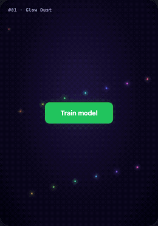
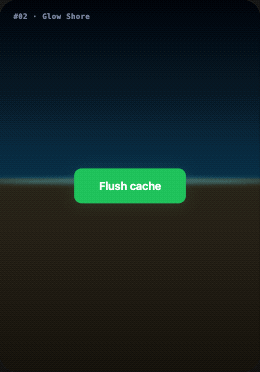
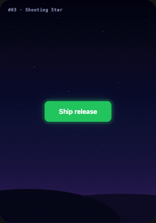
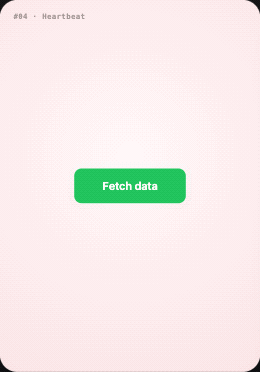
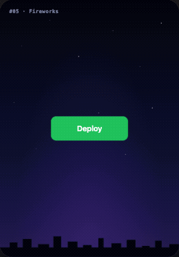
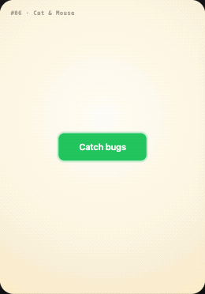
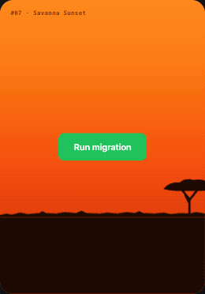
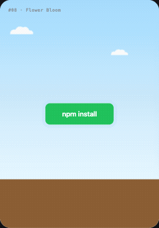
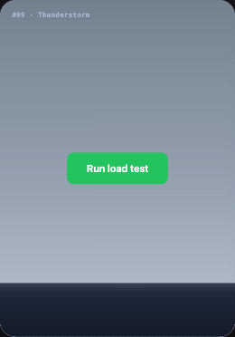
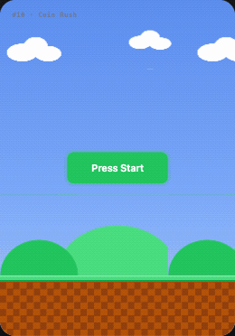

# ✨ React Loaders

**10 loading animations where the button *becomes* the animation.**
Click it and it turns into glowing dust, a shooting star, a beating heart, a thunderstorm… then shows your result.

Zero dependencies. Just React + CSS (and a tiny canvas engine for the glowing ones). Copy a folder, use it.

## 🎬 The loaders

<table>
  <tr>
    <td align="center" width="33%">
      <br>
      <b>01 · Glow Dust</b><br>
      <sub>Dissolves into rainbow dust that <b>follows your finger</b>, then gathers into a ✓</sub>
    </td>
    <td align="center" width="33%">
      <br>
      <b>02 · Glow Shore</b><br>
      <sub>Bioluminescent waves; <b>touch the water</b> to make it glow</sub>
    </td>
    <td align="center" width="33%">
      <br>
      <b>03 · Shooting Star</b><br>
      <sub>A meteor shower; <b>swipe to fling stars</b>, then a ✓ constellation</sub>
    </td>
  </tr>
  <tr>
    <td align="center" width="33%">
      <br>
      <b>04 · Heartbeat</b><br>
      <sub>Morphs into a beating heart with a color-cycling ECG</sub>
    </td>
    <td align="center" width="33%">
      <br>
      <b>05 · Fireworks</b><br>
      <sub>Rockets, peonies, willows and a rainbow finale, with real physics</sub>
    </td>
    <td align="center" width="33%">
      <br>
      <b>06 · Cat &amp; Mouse</b><br>
      <sub>A mouse escapes the button… the cat pounces. <i>Gotcha!</i></sub>
    </td>
  </tr>
  <tr>
    <td align="center" width="33%">
      <br>
      <b>07 · Savanna Sunset</b><br>
      <sub>The button becomes the sun and sets behind a giraffe</sub>
    </td>
    <td align="center" width="33%">
      <br>
      <b>08 · Flower Bloom</b><br>
      <sub>A seed drops, grass grows and seven flowers bloom</sub>
    </td>
    <td align="center" width="33%">
      <br>
      <b>09 · Thunderstorm</b><br>
      <sub>Rain, lightning and thunder… then a rainbow</sub>
    </td>
  </tr>
  <tr>
    <td align="center" width="33%">
      <br>
      <b>10 · Coin Rush</b><br>
      <sub>A pixel robot bonks a <code>{ }</code> block and collects coins</sub>
    </td>
  </tr>
</table>

## 🚀 Run the gallery

```bash
npm install
npm run dev
```

Swipe between cards (or use ← → keys), click a button, and play with the interactive ones.

## 📦 Use one in your app

Every loader lives in its own folder in [`src/loaders/`](src/loaders). Copy the folder into your project and import it:

```jsx
import GlowDust from './GlowDust/GlowDust'

export default function TrainButton() {
  return (
    <div style={{ position: 'relative', width: 420, height: 600, background: '#0b0720' }}>
      <GlowDust label="Train model" onComplete={() => console.log('done!')}>
        {(reset) => (
          <div>
            Model trained ✓ <button onClick={reset}>Replay</button>
          </div>
        )}
      </GlowDust>
    </div>
  )
}
```

**Shared props (every loader)**

| Prop | Type | What it does |
|------|------|--------------|
| `label` | `string` | The button text |
| `onComplete` | `() => void` | Called when the animation finishes |
| `children` | `node` or `(reset) => node` | What to show when it's done. Use the function form to get a `reset()` for a replay button |

**Extra props**

| Loader | Prop | Default |
|--------|------|---------|
| Heartbeat | `beats`: number of heartbeats | `5` |
| Fireworks | `shells`: rockets before the finale (1–6) | `5` |
| Fireworks | `dark`: additive glow for dark backgrounds | `false` |
| Cat & Mouse | `laps`: laps before the pounce | `3` |
| Savanna Sunset | `setMs`: how long the sun takes to set | `4200` |

**Sizing:** Heartbeat, Fireworks and Cat & Mouse have a fixed size. All the others are full scenes that **fill their parent**, so give the parent a size and `position: relative`.

## ➕ Add your own

1. Create `src/loaders/MyLoader/MyLoader.jsx` + `MyLoader.css`
2. Add an entry to the `DEMOS` list in [`src/App.jsx`](src/App.jsx) (name, theme, background, render)

PRs with new loaders are very welcome!

## ⭐ Like it?

If one of these made you smile, **star the repo**. It really helps more people find it.

## License

[MIT](LICENSE)
